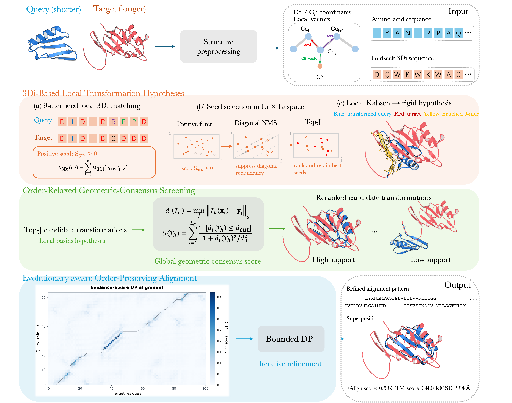

# EAlign

EAlign is a CPU-based method for pairwise protein structure alignment. It
combines amino-acid substitution evidence, the Foldseek 3Di structural
alphabet, local orientation consistency, and geometric proximity in a
coarse-to-fine alignment pipeline.

The program accepts two PDB structures and reports a residue correspondence,
a rigid superposition, local alignment details, and alignment scores. The
release also includes the scripts used for the three experiment groups in the
article:

1. curated pairwise alignment accuracy and runtime on HOMSTRAD, MALIDUP, and
   MALISAM;
2. leave-one-component-out ablations of the EAlign score; and
3. query-level retrieval on the SABmark 1.65 SupFP and TwiFP benchmarks.

## Build

EAlign requires GNU Make and a C++ compiler. The paper experiments used
GCC/G++ 8.5.0 on Linux with `-O3`.
The C++ sources and headers are under `src/`; intermediate objects are written
to `build/`, and the final executable is written to `binary/ealign`.

```bash
make -j
```

To remove generated objects and the executable:

```bash
make clean
```

## Quick start

```bash
binary/ealign protein_1.pdb protein_2.pdb -p 1 -o result
```

The command writes four files in the current directory:

- `result.fasta`: the final two-row sequence alignment;
- `result.pdb`: the aligned structures after superposition;
- `result.local`: local aligned segments and per-segment geometry;
- `result.score`: alignment lengths and EAlign, RMSD, TM-score, GDT, and
  sequence-identity statistics.

Both input files must contain protein coordinates with usable C-alpha atoms.
The command-line order is preserved in the output even when EAlign internally
uses the shorter structure as the query.

## Method summary

EAlign first identifies compatible local fragments using sequence and 3Di
evidence. Candidate rigid transformations are generated from these fragments
and screened geometrically. Promising candidates are converted into
order-preserving residue correspondences and refined with dynamic programming.
The Traceback maximizes total EAlign score, which combines evolutionary evidence with local orientation and
distance-dependent geometric compatibility.




The main implementation is organized as follows:

- `AlignmentPipeline.*` and `PairwiseAligner.*`: end-to-end pipeline;
- `SeedAligner.*`, `FragmentAligner.*`, and `FragmentChainer.*`: local seeds,
  pose generation, and chaining;
- `SequenceScorer.*`, `Foldseek3Di.*`, and `EnvironmentScorer.*`: amino-acid
  and structural-alphabet evidence;
- `AlignmentGeometry.*`, `GeometryUtils.*`, and `Kabsch.*`: transformations
  and geometric scoring;
- `DynamicProgramming.*`, `AlignmentRefiner.*`, and `TMRefiner.*`: alignment
  optimization and refinement;
- `StructureInput.*`, `StructureLoader.*`, and `StructureWriter.*`: structure
  input and output.

## Reproducing the experiments

The experiment scripts are grouped by paper section under
[`experiments`](experiments/README.md):

```text
experiments/
├── 01_pairwise_alignment/
├── 02_score_ablation/
└── 03_sabmark_retrieval/
```

Benchmark datasets and saved analysis results are provided as separate ZIP
archives in this repository. Third-party executables are not bundled. See
`experiments/README.md` for the expected directory layout,
dependencies, exact commands, output locations, and benchmark protocol.

The reported experiments used CentOS Linux 8, GCC/G++ 8.5.0, two Intel Xeon
Gold 5218 CPUs, and CPU-only execution.
